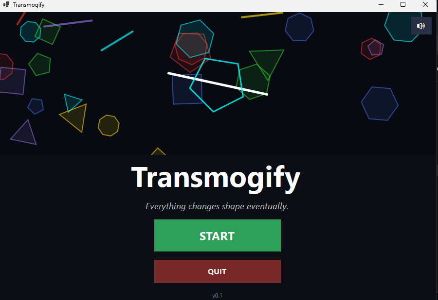
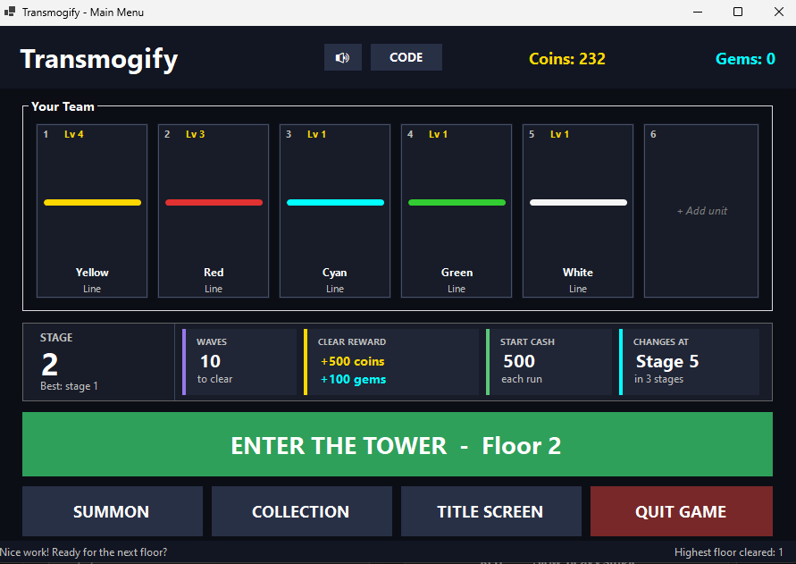
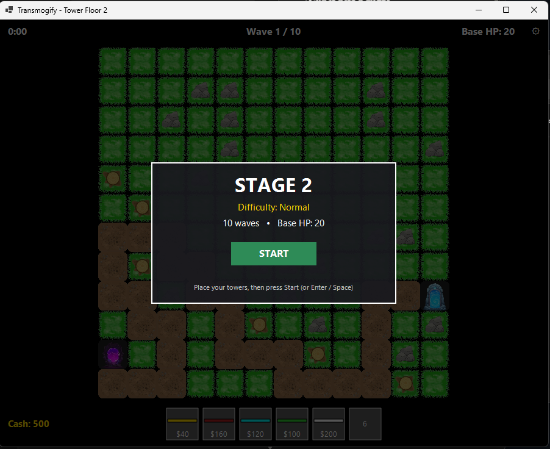
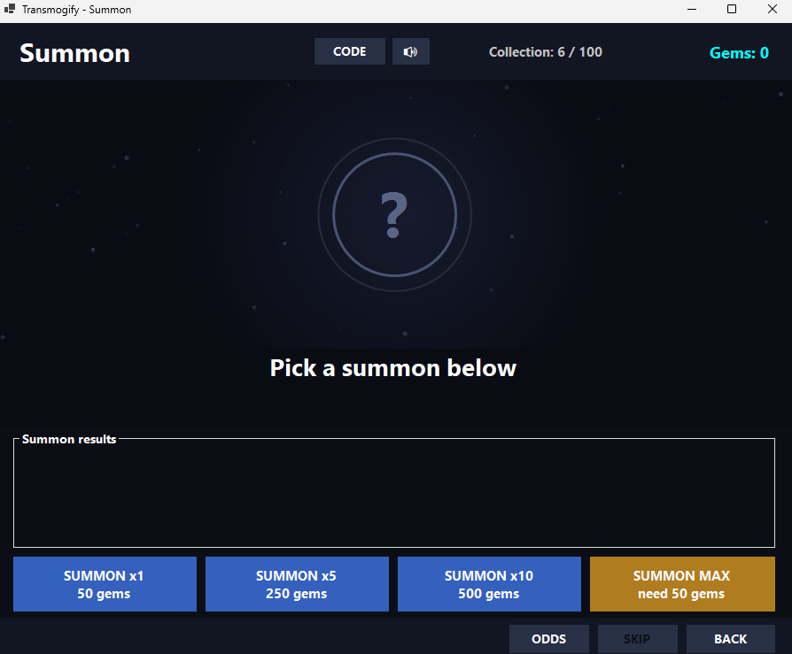
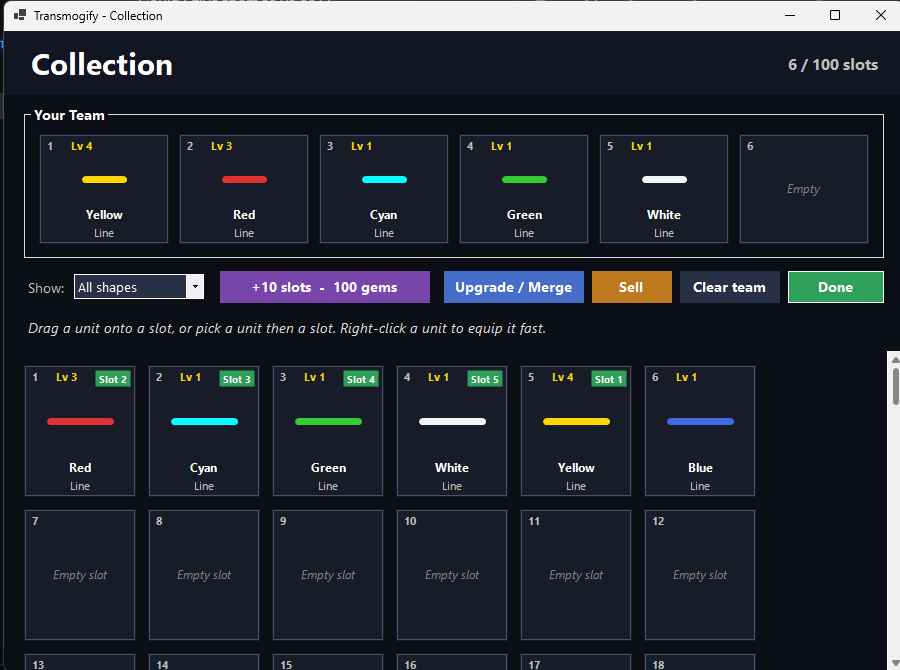
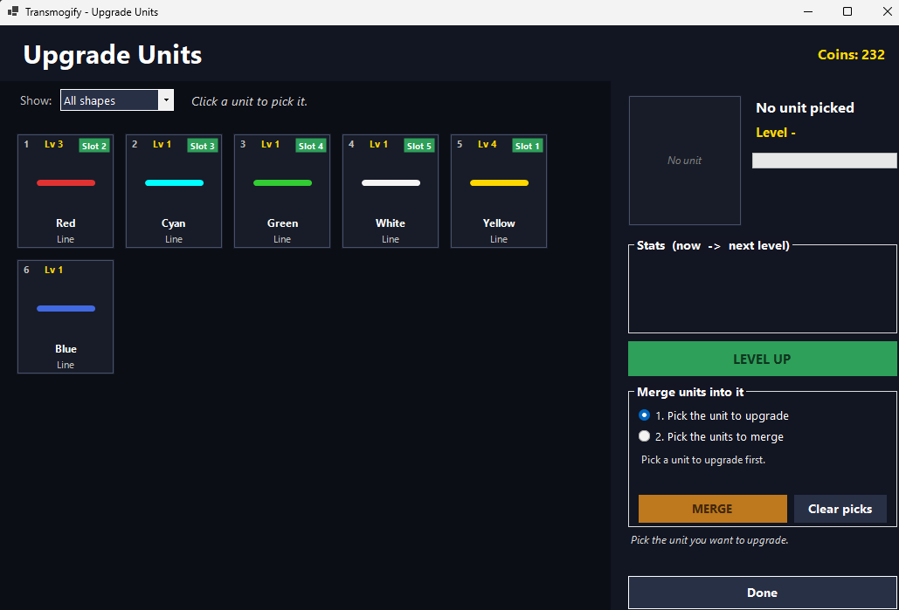
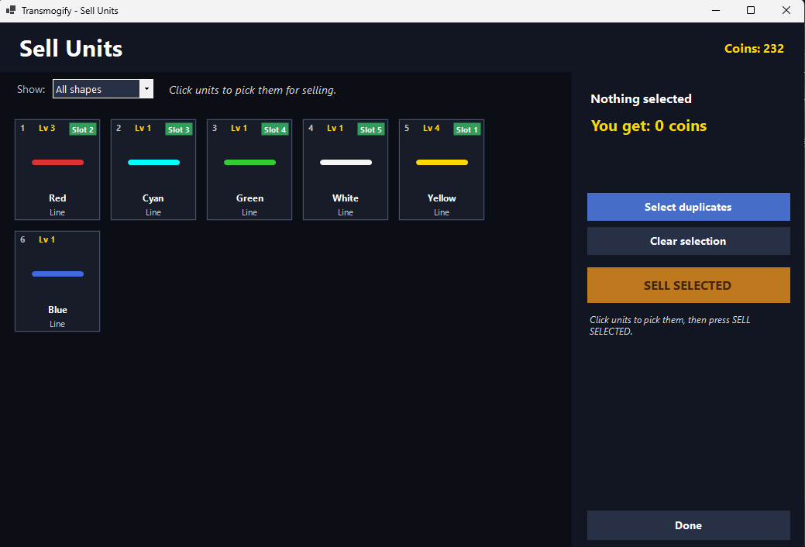

# Transmogify

> *Everything changes shape eventually.*

A tower defense game with a gacha twist, made in C# with Windows Forms. Summon shapes, build a team of six, and defend the floor as waves of enemies walk the path. The higher you climb, the nastier it gets.

## Screenshots

<p>
  
  
</p>
<p>
  
  
</p>
<p>
  
  
</p>
<p>
  
</p>

## Features

- **Gacha summoning** – spend gems to pull shapes (Line, Triangle, Square, Pentagon, Hexagon) in eight colors. Rarer shapes become more likely the higher your stage.
- **Color = role** – every color plays differently:
  | Color | Role |
  |---|---|
  | Red | Slow, heavy single-target hits |
  | Yellow | Rapid, light attacks |
  | Cyan | Damages multiple enemies |
  | Blue | Long range, hits elevated enemies too |
  | Green | Poison damage over time |
  | Purple | Stuns enemies |
  | Black | Damage plus slow |
  | White | Buffs nearby allies |
- **Team of 6** – pick your lineup from your collection before entering the tower.
- **Endless tower** – randomly generated floors, a difficulty tier (Easy → Extreme) rolled per floor, and tougher enemies with boss waves as you climb.
- **Collection management** – level units up by merging duplicates (max level 50), sell extras for coins, and expand your collection slots with gems.
- **Redeem codes**, auto-saving progress and a music player with crossfade.

## Requirements

- Windows 10/11
- [.NET 10 SDK](https://dotnet.microsoft.com/download) (to build) or the .NET 10 Desktop Runtime (to run a framework-dependent build)

## Play

Grab the latest build from the [**Releases**](../../releases) page, unzip it, and run `TDGachaGame.exe`.

## Build from source

```bash
git clone https://github.com/<your-username>/TDGachaGame.git
cd TDGachaGame
dotnet run
```

Or open `TDGachaGame.slnx` in Visual Studio 2022 (17.14+) / 2026 and press **F5**.

The project expects an `Assets/` folder (PNG images) and a `music/` folder (`.mp3`, `.wav`, `.wma`, `.m4a`) next to the project file; both get copied to the output directory on build.

## Project layout

| File(s) | What it does |
|---|---|
| `Form2` | Title screen |
| `Form3` | Main hub: stage info, team, enter tower, summon, collection |
| `Form1` | The tower defense gameplay itself |
| `Form4` | Collection and team editing |
| `Form6` | Summon (gacha) screen |
| `Form7` / `Form8` | Upgrade/merge units and sell units |
| `Form5` | Redeem code window |
| `GachaSystem.cs` | Pull odds, scaled by stage |
| `TowerManager.cs`, `TowerUpgradeConfig.cs` | Tower behavior and stats |
| `EnemyManager.cs`, `EnemyStatsTable.cs`, `FloorEnemyGenerator.cs` | Enemies and wave generation |
| `FloorMap.cs`, `StageProgression.cs` | Floor generation and difficulty curve |
| `PlayerProfile.cs`, `SavaManager.cs`, `SaveData.cs` | Player data and saving |
| `MusicPlayer.cs` | Background music |

## Saves

Progress is stored as JSON at `%AppData%\TDGachaGame\save.json`. Delete it to start fresh.

## Tech

C# · .NET 10 · Windows Forms (WPF `MediaPlayer` for audio)

## License

No license yet. Add one (e.g. MIT) if you want others to reuse the code.
